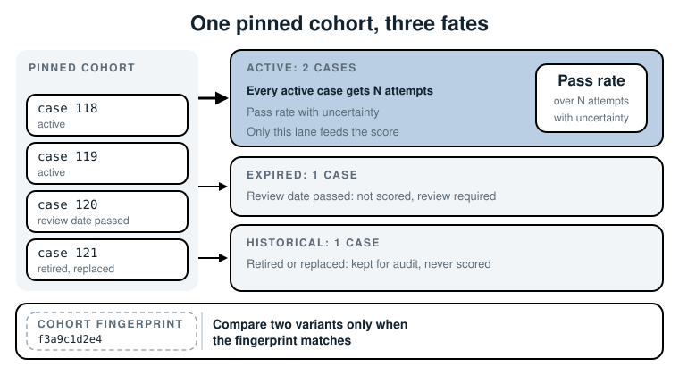

## 9. Turn Scores into a Benchmark

*One run is a sample. A benchmark pins the cases, repeats the attempts, and
refuses to compare numbers that were not measured on the same set.*

Chapter 8 ended with ten versions and a warning: version 10 looked better, but we
had not rerun versions 01 to 06 with its prompt. That is not a benchmark. It is a
pile of runs that happen to share a scenario file.

The difference matters because an agent is stochastic. The model can pick another
tool order, phrase the cause differently, or skip a log line on a second try. A
single pass tells you that a run *can* pass. It does not tell you how often it
does. A benchmark answers the second question, and it does so without letting you
quietly change the test while you chase a nicer number.

### What a benchmark adds

Three rules turn a folder of cases into a benchmark.

1. **Pin the set.** The benchmark names its cases, their files, their status, and
   their coverage. A hash of that set becomes the cohort fingerprint.
2. **Repeat every active case.** Each case gets the same number of attempts. A
   failed attempt stays in the denominator. An attempt with no complete grade is
   reported, not dropped.
3. **Compare only equal cohorts.** Two reports may be compared only when their
   fingerprints and attempt counts match. A new case, a retired case, or an edited
   answer key means the old score is history, not a baseline.



Read the figure left to right. One manifest fans into three fates. Only the
active lane reaches the score. Expired cases need a review before they can return;
historical cases stay for audit and never enter a number. The fingerprint at the
bottom is the permission slip for a comparison.

### Step 1: pin the set

The Chapter 9 folder adds [manifest.json](./code/chapter-09/manifest.json) to the
case files you already have. It is deliberately boring:

```json
{
  "cohort_id": "checkout-incidents-2026-09",
  "created_at": "2026-09-24",
  "required_coverage": [
    "db_pool",
    "payment_dependency",
    "worker_capacity"
  ],
  "policy": {
    "min_attempts_per_case": 3,
    "min_pass_rate": 0.8,
    "max_ungraded_attempts": 0
  }
}
```

The `cases` list points at the files and gives each one a fate:

- `pool` → `scenarios/checkout-latency.json` (active, covers `db_pool`)
- `dependency` → `scenarios/payment-dependency.json` (active, covers
  `payment_dependency`)
- `capacity` → `scenarios/worker-capacity.json` (active, covers
  `worker_capacity`)
- `pool-2025` → `scenarios/checkout-latency-2025.json` (historical, covers
  `db_pool`)

A historical entry carries its review record:

```json
{
  "id": "pool-2025",
  "path": "scenarios/checkout-latency-2025.json",
  "status": "historical",
  "covers": "db_pool",
  "superseded_by": "pool",
  "retired": {
    "reason": "Recorded before the 2025 topology change.",
    "owner": "checkout on-call",
    "reviewed_at": "2026-09-24"
  }
}
```

The older recording is still a valid file. It is not an active test. That is the
point of keeping it: the next time someone asks why the pool case changed, the
answer is in the repository instead of in a chat thread.

The fingerprint hashes the cohort ID, each case ID, status, coverage label, and
the bytes of each case file:

```python
def fingerprint(manifest):
    digest = hashlib.sha256()
    digest.update(manifest.cohort_id.encode("utf-8"))
    for case in manifest.cases:
        body = (manifest.base_dir / case.path).read_bytes()
        for value in (case.id, case.status, case.covers):
            digest.update(b"\0")
            digest.update(value.encode("utf-8"))
        digest.update(b"\0")
        digest.update(hashlib.sha256(body).digest())
    return "sha256:" + digest.hexdigest()
```

Change one character in one answer key and the fingerprint changes. That is
intentional. It is cheaper to rerun a cohort than to explain a comparison between
two different tests.

### Step 2: give each case a fate

At scoring time, the manifest is not enough. A case can also expire. Chapter 5
gave every case a `review_by` date; the benchmark reads it and sorts the set into
three groups:

```python
if case.status == "historical":
    historical.append(case)
elif today > case_review_by(manifest, case):
    expired.append(Expired(id=case.id, review_by=review_by))
else:
    active.append(case)
```

Only `active` reaches the agent. Expired cases are listed in the report, not
scored. Historical cases are listed by their replacement and retirement reason.
An attempt recorded against an expired or historical case raises an error instead
of joining the denominator.

Here is what the split looks like after the review dates pass. Run this drill from
`code/chapter-09/`:

```bash
python run_benchmark.py \
  --replay replay/attempts-baseline.json \
  --runs 3 --today 2027-01-01 \
  --report reports/expiry-drill.json
```

```text
Cohort: checkout-incidents-2026-09
Active: none
Expired, not scored: pool, dependency, capacity
Historical, not scored: pool-2025
...
Benchmark is unhealthy: an active case passed its review date.
```

The command exits nonzero even though the report is complete. A benchmark that
quietly scores an empty active set is worse than a failed one: it prints a number
with no cases behind it.

### Step 3: repeat every active case

The runner takes the manifest, the variant, and a repeat count. It runs every
active case exactly that many times, in parallel, and writes one report:

```bash
python run_benchmark.py --variant baseline --runs 3
```

The book's example uses a recorded replay so the chapter runs without provider
keys:

```bash
python run_benchmark.py \
  --replay replay/attempts-baseline.json \
  --runs 3 --report reports/benchmark-baseline.json
```

```text
Cohort: checkout-incidents-2026-09
Fingerprint: sha256:0a5bc5839b8f…
Variant: baseline
Attempts per case: 3

case                      att  pass  rate   95% CI     ungraded
pool                      3    2     67%    [21%,94%]  0
dependency                3    0     0%     [0%,56%]   0
capacity                  3    1     33%    [6%,79%]   0

Overall: 3/9 passes (33%, 95% CI [12%, 65%])
Expired (not scored): none
Historical (not scored): pool-2025
```

Three attempts made nine attempts total. That is still a small sample, and the
report says so. The interval around `67%` runs from `21%` to `94%`. The interval
around `0%` runs from `0%` to `56%`. You cannot read a two-point difference
between those cases as a fact.

The replay fixtures declare `"replay": true`, and the runner prints
`Source: recorded replay (no model calls)`. They exist to keep this chapter
runnable and to make the aggregation rules visible. They are not evidence about
a live model. With your own keys, `--variant baseline` and `--variant candidate`
replace them with real runs, and the same report is written.

### Step 4: score the same set twice

A benchmark becomes useful when you change one thing and rerun the same cohort.
The second variant adds the Chapter 8 instruction about naming each rejected log
signal after its component:

```bash
python run_benchmark.py \
  --replay replay/attempts-candidate.json \
  --runs 3 --report reports/benchmark-candidate.json
python compare.py \
  reports/benchmark-baseline.json \
  reports/benchmark-candidate.json
```

```text
Cohort: checkout-incidents-2026-09
Fingerprint: sha256:0a5bc5839b8f…
Variant: candidate
Attempts per case: 3

case                      att  pass  rate   95% CI     ungraded
pool                      3    3     100%   [44%,100%] 0
dependency                3    1     33%    [6%,79%]   0
capacity                  3    3     100%   [44%,100%] 0

Overall: 7/9 passes (78%, 95% CI [45%, 94%])
```

```text
Baseline:  baseline
Candidate: candidate

case                      base  cand  delta  CI
pool                      67%   100%     +33% overlap
dependency                0%    33%      +33% overlap
capacity                  33%   100%     +67% overlap

Overall: 33% -> 78% (+44%), CI overlap

An overlapping interval is not evidence of improvement. Add attempts,
not adjectives, before you claim the change worked.
```

The candidate is better on every case, and the overall rate moved by 44 points.
The intervals still overlap. That is not a contradiction; it is what nine
attempts can support. The honest conclusion is: *the direction is promising, and
the sample is too small to call it an improvement.* Run more attempts before you
put that sentence in a release note.

The comparison tool refuses a mismatch instead of guessing:

```text
ValueError: cohorts differ; re-run both variants on the same pinned set
```

It also refuses reports with different attempt counts. A candidate measured with
three attempts per case is not comparable to a baseline measured with one.

### What the rate does not include

A benchmark report is more than its pass rate. Read four other fields first:

- **`ungraded`** — attempts with no complete grade. These are not failures and
  not passes. The runner exits nonzero when the maximum is exceeded, because a
  benchmark with missing grades cannot be compared.
- **`expired`** — active cases that are past review. They are not scored, even if
  the report also lists them from an older run.
- **`historical`** — retired or replaced cases. They are kept, named, and never
  scored.
- **`attempts_per_case`** — the repeat count. Different counts invalidate a
  comparison.

There is one more field outside the report: the model and rubric versions. The
agent model is recorded in the report. The judge model and rubric are recorded on
every attempt. Change either, and the numbers belong to a different grader.

### What this benchmark cannot tell you

- **It cannot tell you that coverage is complete.** The manifest lists the
  coverage you decided to require. If a whole failure family is missing, every
  case can pass. Chapter 11 gates the manifest, not just the score.
- **It cannot calibrate Jev.** A judge that is consistently too generous produces
  a consistently green benchmark. Chapter 8's human labels are the calibration
  set.
- **It cannot predict production.** These are recorded cases with known answers.
  A high pass rate on them is evidence about this suite, not a promise about next
  week's incident.
- **It cannot stop benchmark overfitting.** If you tune instructions against the
  same three cases for long enough, you will fit the cases. Add new cases from
  real misses; Chapter 10 does exactly that.

### Where else this applies

A support agent's benchmark pins the tickets, the policy IDs, and the escalation
outcomes. A SQL agent's pins the database snapshot, the expected rows, and the
query-cost ceiling. In every case the rule is the same: repeat the attempts, keep
the active set honest, and compare only equal cohorts. The model may change
between runs. The test may not.

### Summary

- A benchmark pins the cases, repeats each active case the same number of times,
  and scores only the active set.
- Expired and historical cases are reported separately and never enter the rate.
- The cohort fingerprint makes an unequal comparison impossible.
- A pass rate without its interval and attempt count is a story, not a measurement.
- Change one variant, rerun the same cohort, and add attempts before you claim an
  improvement.

Next: the benchmark can only score cases you already recorded. When production
finds a new kind of failure, turn that miss into a reviewed test.
