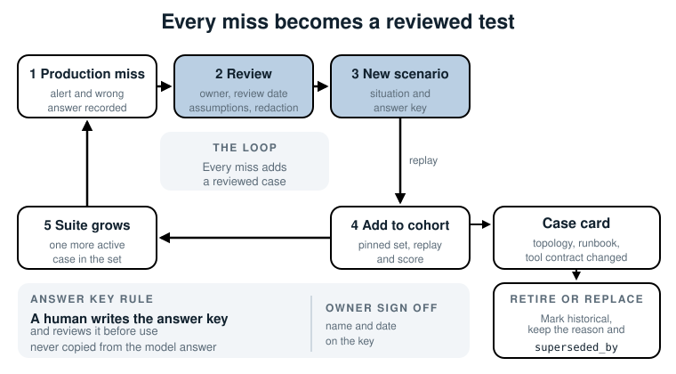

## 10. Close the Loop: Every Miss Becomes a Test

*The benchmark can only score cases you already recorded. When the agent misses
something new, that miss is the next case — after a human reviews it.*

A benchmark that never grows is a museum. It tells you how the agent handles the
incidents you thought of when you built it. Production will find the ones you did
not.

This chapter takes one saved miss, decides what kind of miss it is, records it as
a case, extends the grader for its new cause shape, adds it to the pinned cohort,
and keeps the retirement history when an old case stops representing the system.

### Three kinds of miss

Not every miss deserves a new case. Before you write a scenario, decide which one
you have:

| Kind | What happened | What to change |
|---|---|---|
| **Model miss** | The case was fair, the evidence was visible, and the agent still got it wrong | Add attempts, inspect the trajectory, change the agent |
| **Case bug** | The answer key is ambiguous or the expected evidence was not actually available | Fix the case under review, then rerun the whole cohort |
| **Suite gap** | The incident has a cause shape no current case covers | Record a new case and extend the grader |

Chapter 8 gave us an example of the second kind. The agent rejected `db`; the
answer key expected `db_pool` or a name starting with `db_pool_`. Is `db` close
enough? That is a scoring-rule decision, not a model bug. The correct move is to
decide it on purpose, record the decision, and rerun every case — not to edit the
key until the table turns green.

The cache-stampede incident in this chapter is the third kind. A deploy set
`CACHE_TTL` to zero, every product read missed the cache, and the database query
rate rose about thirteenfold. No existing case has that mechanism. The saved miss
also has a tempting distraction: a payment-provider line that appears four
minutes *after* the alert.



The loop is the unit of improvement. A miss enters at the top left, a reviewer
turns it into a scenario and an answer key, and the pinned cohort grows. The side
branch is just as important: when the system changes, the case leaves the active
set through a recorded retirement, not through a quiet deletion.

### Step 1: capture the miss

You cannot reconstruct a run from memory. Capture the alert, the recorded tool
responses, the conclusion, the trajectory, and the gates while they still exist.
[The saved miss](./code/chapter-10/misses/checkout-cache-stampede.json) is the
record:

```json
{
  "scenario_id": "checkout-cache-stampede",
  "observed_at": "2026-11-07",
  "agent_model": "scripted-replay",
  "conclusion": {
    "root_cause": "Payment-provider latency rose to 900ms.",
    "category": "dependency",
    "cause_effect": "dependency_slow",
    "tool_calls": ["get_metrics", "get_logs"],
    "steps": 3
  },
  "hard_gates": {
    "cause": false,
    "evidence": false,
    "distraction": false,
    "steps": true
  },
  "status": "fail"
}
```

The label `scripted-replay` is honest: this drill uses a recorded conclusion so
the chapter runs without model keys. The shape is the same as a production miss.
When you capture your own, keep the provider's model name and the timestamp.

The miss record is evidence, not the answer key. The agent's paragraph explains
what it *thought*. The answer key must explain what the recorded data *proves*.

### Step 2: review before you write the answer key

A case is not a transcript with a grade attached. It is a reviewed test. The
draft in [the inbox](./code/chapter-10/inbox/checkout-cache-stampede.json) adds
the review fields to the scenario:

```json
"validity": {
  "owner": "checkout on-call",
  "recorded_at": "2026-11-07",
  "review_by": "2027-02-07",
  "assumptions": {
    "topology": "checkout-db-pool-v1",
    "runbook": "checkout-latency-v2",
    "tool_contract": "incident-tools-v1"
  },
  "source": {
    "kind": "production_miss",
    "reference": "misses/checkout-cache-stampede.json",
    "observed_at": "2026-11-07"
  }
}
```

`register_case.py` validates five things before it touches the cohort:

- the case ID is kebab-case and unique;
- the owner is named and the review date is in the future;
- the assumptions are nonempty and the source record exists;
- every required-evidence tool has a recorded response;
- the distraction marker appears *after* the alert in the recorded lines.

The last rule is the one people skip. A distraction that the agent could never
see is not a distraction. If the marker is before the alert, or in a tool the case
never requires, the case is testing luck.

The reviewer writes `true_cause`, `cause_change`, `cause_effect`, and
`required_evidence` from the recorded responses. The model's answer is not copied
into any of them. That separation is what lets the same file grade a different
agent later.

### Step 3: extend the contract when the cause shape is new

The existing grader knows three effects: `pool_exhausted`, `dependency_slow`, and
`capacity_limit`. A cache stampede is none of them. Pretending otherwise would
force the case into a shape it does not have.

Two small changes are needed. First, the agent's answer schema must allow the new
effect, or the model cannot name it:

```python
"enum": ["pool_exhausted", "dependency_slow", "capacity_limit",
         "cache_stampede", "unknown"]
```

Second, the grader needs a deterministic check for that effect. The deploy is the
cause, and the pool response proves the mechanism:

```python
elif answer.cause_effect == "cache_stampede":
    supported_effect = (
        pool.get("cache_hit_pct", 100) <= 5
        and pool.get("baseline_qps", 0) > 0
        and pool.get("qps", 0) >= 3 * pool["baseline_qps"]
        and any("cache miss" in line.lower() for line in logs)
    )
```

The cause gate now accepts a deploy as the supported change for both
`pool_exhausted` and `cache_stampede`. That is not a loosening; it is the same
rule — the named change must appear in `get_deploys` before the alert, and the
effect must appear in the recorded responses.

When you add a cause shape, add a test for it. A grader branch with no test is a
guess with a green checkmark.

### Step 4: register the case

Validate first. The dry run prints what would change and writes nothing:

```bash
python register_case.py \
  inbox/checkout-cache-stampede.json \
  --covers cache_stampede --today 2026-11-07
```

Then apply it:

```bash
python register_case.py \
  inbox/checkout-cache-stampede.json \
  --covers cache_stampede --today 2026-11-07 --apply
```

```json
{
  "action": "register",
  "case": {
    "id": "checkout-cache-stampede",
    "path": "scenarios/checkout-cache-stampede.json",
    "status": "active",
    "covers": "cache_stampede"
  },
  "dry_run": false
}
```

Registration does three things: it copies the reviewed draft into `scenarios/`,
appends an active entry to the manifest, and adds `cache_stampede` to
`required_coverage`. That last step matters. A case that is not required can
silently disappear from a future manifest. Once the incident family is real, its
coverage is required.

`manifest-before.json` in the Chapter 10 folder is the cohort before this change:
the cache case is absent and the older pool recording is still active. The
runnable [manifest.json](./code/chapter-10/manifest.json) is the cohort after
both changes.

### Step 5: score it in the same cohort

A new case is not a benchmark until it shares the same attempts and the same
fingerprint as the rest. Run the four-case cohort:

```bash
python run_benchmark.py \
  --replay replay/attempts-after-registration.json \
  --runs 3 --report reports/benchmark-after-registration.json
```

```text
Cohort: checkout-incidents-2026-09
Fingerprint: sha256:eb709d8796e2…
Variant: candidate
Attempts per case: 3

case                      att  pass  rate   95% CI     ungraded
pool                      3    3     100%   [44%,100%] 0
dependency                3    2     67%    [21%,94%]  0
capacity                  3    3     100%   [44%,100%] 0
checkout-cache-stampede   3    2     67%    [21%,94%]  0

Overall: 10/12 passes (83%, 95% CI [55%, 95%])
```

The new case is not a bonus point. It changes the denominator, the coverage
requirements, and the fingerprint. Any report written before registration is now
an old-cohort report, even if every number in it is still correct. Chapter 11
makes that mismatch a failed build.

### Step 6: retire or replace when the system changes

Cases go stale for ordinary reasons: the topology changes, a runbook is rewritten,
a tool response gains a field, or a newer recording represents the same incident
better. Retiring is a reviewed action, not a delete:

```bash
python retire_case.py \
  --manifest manifest-before.json \
  --id pool-2025 \
  --reason "Superseded by the 2026 pool recording" \
  --owner "checkout on-call" --replaced-by pool \
  --today 2026-11-07
```

```json
{
  "action": "retire",
  "case": {
    "id": "pool-2025",
    "status": "historical",
    "retired": {
      "reason": "Superseded by the 2026 pool recording",
      "owner": "checkout on-call",
      "reviewed_at": "2026-11-07"
    },
    "superseded_by": "pool"
  },
  "dry_run": true
}
```

Add `--apply` to write it. The case file stays. The manifest keeps who retired it,
when, why, and what replaced it. A future reader can tell the difference between
"we forgot this case" and "we retired it on purpose."

Retirement has one hard rule: a replacement must be active. You cannot point a
retired case at another retired case and call the coverage complete.

### The rule that keeps the loop honest

Never edit an answer key to turn a miss green. If the case is wrong, fix it under
review, record why, and rerun the entire cohort. If the model is wrong, change the
agent and rerun the entire cohort. If the system changed, retire the case and add
its replacement.

The temptation is always the same: one small exception, one adjusted threshold,
one case quietly excluded. Each one makes the next comparison a little less true.
The manifest exists so those changes are visible in a diff.

### Where else this applies

A support agent's miss becomes a ticket scenario with the policy ID and the
escalation outcome. A coding agent's miss becomes a repository snapshot with the
failing test and the expected patch. A SQL agent's miss becomes a query, a
snapshot, and the correct rows. In each case the pattern is identical: capture the
run, review the case, extend the contract only when the cause shape is genuinely
new, and register it in the pinned set.

### Summary

- A miss is evidence, not an answer key. A human writes the expected answer from
  the recorded data.
- Decide whether the miss is a model miss, a case bug, or a suite gap before you
  change anything.
- A new cause shape needs an agent schema change and a tested grader branch.
- Registration adds the case to the active cohort *and* to required coverage.
- Retirement keeps the file, the reason, the reviewer, and the replacement.
- Never edit the key to make a miss green.

Next: run the benchmark on every pull request and refuse to merge when either the
agent or the suite behind it is unhealthy.
