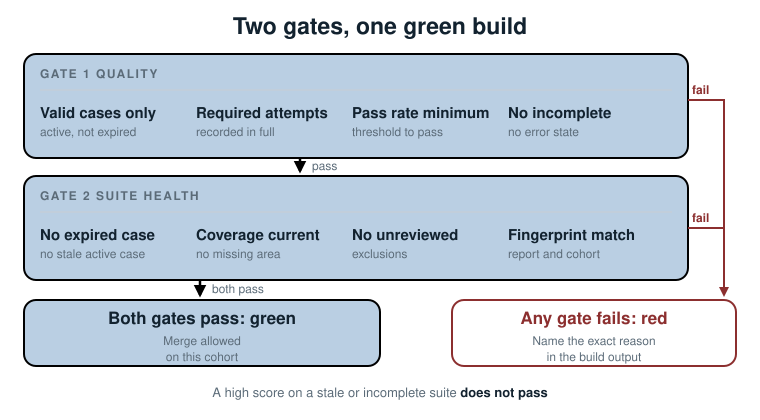

## 11. Gate Your Agent in CI

*A benchmark that runs when someone remembers is a dashboard. A gate runs on
every change and refuses to merge when the agent — or the suite behind it — is
unhealthy.*

Chapter 9 gave you a number you can trust a little. Chapter 10 gave you a way to
grow the suite without lying to yourself. Neither matters if the benchmark only
runs on a laptop after a release.

The final step is to put the benchmark in the pull request. The gate has to answer
two questions, and it must answer both before it prints green:

1. **Is the agent good enough on the active cases?**
2. **Is the suite that measured it still valid?**

A high score cannot rescue an unhealthy suite. That rule is the whole chapter.

### Two gates, not one

The quality gate reads the report: attempts, ungraded results, overall pass rate,
and a per-case floor. The suite-health gate reads the manifest and today's date:
expired active cases, required coverage, retirement reviews, and the cohort
fingerprint.

They are separate on purpose. A report can show 83% while half its cases are past
review. A manifest can be perfectly fresh while every case fails. Only both gates
together describe a build you can trust.



### Step 1: put the policy in the manifest

Thresholds belong next to the cohort, not in a CI variable that nobody reviews.
The Chapter 11 [manifest.json](./code/chapter-11/manifest.json) adds them to the
policy block:

```json
"policy": {
  "min_attempts_per_case": 3,
  "min_pass_rate": 0.8,
  "min_case_pass_rate": 0.5,
  "max_ungraded_attempts": 0,
  "max_retirement_age_days": 365
}
```

Each field answers a question a reviewer will ask:

- **`min_attempts_per_case`** — how many tries before a rate is meaningful?
- **`min_pass_rate`** — what overall quality is required to merge?
- **`min_case_pass_rate`** — how far can one case fall before the overall average
  hides it?
- **`max_ungraded_attempts`** — how many missing grades are tolerated? Zero is the
  right default.
- **`max_retirement_age_days`** — how long may an exclusion go unreviewed?

Changing a threshold is a product decision. It should be a separate, reviewed
change — not a line in the same pull request as the agent fix.

### Step 2: run the benchmark in CI

The workflow installs the dependencies, runs the offline tests, scores the active
cohort, and gates the report. The important lines from
[ci-example.yml](./code/chapter-11/ci-example.yml):

```yaml
- name: Test the gate offline
  run: python -m unittest test_gate.py test_benchmark.py

- name: Score the active cohort
  run: >-
    python run_benchmark.py --variant candidate --runs 3
    --report reports/ci.json
  env:
    OPENAI_API_KEY: ${{ secrets.OPENAI_API_KEY }}
    OPENAI_MODEL: gpt-4.1-mini
    CLOUDFLARE_ACCOUNT_ID: ${{ secrets.CF_ACCOUNT_ID }}
    CLOUDFLARE_API_TOKEN: ${{ secrets.CF_API_TOKEN }}
    JEV_MODEL: ${{ secrets.JEV_MODEL }}

- name: Gate quality and suite health
  run: python gate.py reports/ci.json
```
Put the provider keys in a protected environment. Never put them in the
repository, a scenario file, or a report. Upload the report as an artifact even
when the gate fails; the failing rows are the point.

A benchmark that takes too long for every pull request can move to a nightly run,
but do not shrink the cohort silently. If you score a subset, give it its own
manifest and its own fingerprint. A smoke cohort is a different benchmark, not a
shortcut through this one.

### Step 3: a green build

The recorded replay produces the same four-case cohort Chapter 10 registered:

```bash
python run_benchmark.py \
  --replay replay/ci-attempts.json \
  --runs 3 --report reports/ci-green.json
python gate.py reports/ci-green.json
```

```text
QUALITY
  PASS  cohort fingerprint matches
  PASS  every active case scored
  PASS  no inactive case scored
  PASS  attempts per case: 3 (min 3)
  PASS  ungraded attempts: 0 (max 0)
  PASS  overall pass rate: 83% (min 80%)
  PASS  per-case floor

SUITE HEALTH
  PASS  no expired active cases
  PASS  coverage complete
  PASS  exclusions reviewed

RESULT: GREEN
```

The report behind it was 10 passes in 12 attempts. The weakest case, dependency,
still cleared its 50% floor at 67%. The gate did not need to know which case was
weak; it checked the floor and the overall rate.

### Step 4: the suite can turn red without the score moving

This is the failure a score-only gate misses. The same report, gated after the
review dates pass:

```bash
python gate.py reports/ci-green.json --today 2026-12-20
```

```text
QUALITY
  PASS  cohort fingerprint matches
  PASS  every active case scored
  FAIL  no inactive case scored
        unexpected: capacity, dependency, pool
  PASS  attempts per case: 3 (min 3)
  PASS  ungraded attempts: 0 (max 0)
  PASS  overall pass rate: 83% (min 80%)
  PASS  per-case floor

SUITE HEALTH
  FAIL  no expired active cases
        expired: pool, dependency, capacity
  FAIL  coverage complete
        missing: db_pool, payment_dependency, worker_capacity
  PASS  exclusions reviewed

RESULT: RED
```

The report still says 83%. The gate still says red, because three cases are past
review and their coverage families have no active case. That is exactly what
should happen: an old score cannot speak for a system whose cases no longer
represent it.

Wait long enough and the exclusion review ages out too:

```bash
python gate.py reports/ci-green.json --today 2028-01-01
```

```text
SUITE HEALTH
  FAIL  no expired active cases
        expired: pool, dependency, capacity,
        checkout-cache-stampede
  FAIL  coverage complete
        missing: db_pool, payment_dependency, worker_capacity,
        cache_stampede
  FAIL  exclusions reviewed: stale: pool-2025

RESULT: RED
```

An unreviewed exclusion is not a neutral omission. It is a case someone stopped
scoring without saying why. The gate treats it as a failure.

### Step 5: an old report cannot ride a new cohort

The most common CI failure is not a bad agent. It is a stale report. The manifest
changed — a case was added, retired, or edited — and the pipeline gated a report
produced before that change:

```text
QUALITY
  FAIL  cohort fingerprint matches
        rerun on the current manifest
  FAIL  every active case scored
        missing: checkout-cache-stampede
  PASS  no inactive case scored
  PASS  attempts per case: 3 (min 3)
  PASS  ungraded attempts: 0 (max 0)
  FAIL  overall pass rate: 78% (min 80%)
  FAIL  per-case floor: below 50%: dependency 33%

SUITE HEALTH
  PASS  no expired active cases
  PASS  coverage complete
  PASS  exclusions reviewed

RESULT: RED
```

The fix is not to lower the threshold. The fix is to rerun both variants on the
current fingerprint, then read the new report. That is what a pinned cohort is
for.

### When the gate is red

| Failure | What it means | First move |
|---|---|---|
| Fingerprint mismatch | The report came from another cohort | Rerun both variants on the current manifest |
| Missing active case | A case was added but never scored | Run the case; check coverage |
| Unbalanced attempts | The samples are not comparable | Give every active case the same count |
| Ungraded attempts | Judge or model transport failed | Fix the transport; do not raise the maximum |
| Overall rate below threshold | The agent regressed, or the cases got harder | Inspect the failing cases and the changed instructions |
| Per-case floor failed | One family collapsed behind a healthy average | Inspect that case before the average |
| Expired active case | The review date passed | Review the case; extend or replace it |
| Coverage gap | A required family has no active case | Add the missing case or restore it |
| Stale exclusion | A retirement was not re-reviewed | Re-review or restore the case |

No row says "lower the number." The threshold is a promise about what you will
ship, not a knob for making the build green.

### Keep the gate honest

- **Pin the model and rubric.** The report records the agent model; every attempt
  records the judge model and rubric. A change to either is a new grader. Gate it,
  or the comparison is meaningless.
- **Run on the pull request, not after the merge.** A gate that runs after deploy
  is a postmortem generator.
- **Keep the artifact.** Store the report and its failures. When someone asks why
  a release was blocked six weeks ago, the rows are the answer.
- **Review the suite on a schedule.** Expiry dates are not paperwork. They are the
  mechanism that stops old recordings from grading a new system.
- **Do not exclude a case to go green.** Retire it with a reason, an owner, a
  review date, and a replacement. Then rerun the cohort.

### Where else this applies

A support agent's gate checks ticket resolution and policy compliance, then fails
if the policy catalog changed without the scenarios. A SQL agent's gate checks
result correctness and query cost, then fails if the database snapshot is stale.
A coding agent's gate checks the failing tests and the patch, then fails if the
repository fixture no longer matches the branch. The details differ; the shape is
the same: quality on valid cases, plus the health of the suite that measured it.

### Summary

- Gate quality and suite health together; either one alone can be green for the
  wrong reason.
- Pin thresholds in the manifest and change them in a reviewed pull request.
- Rerun the cohort when the fingerprint changes; never reuse an old report.
- Fail on expired cases, missing coverage, unreviewed exclusions, and ungraded
  attempts.
- A red gate names the reason. "Lower the threshold" is not a reason.

The harness is now a loop: record a case, replay it, hide the answer, score it,
judge the explanation, benchmark the cohort, turn misses into cases, and gate the
next change. The agent can keep changing. The evidence keeps up.

Next: the resources that go deeper.
